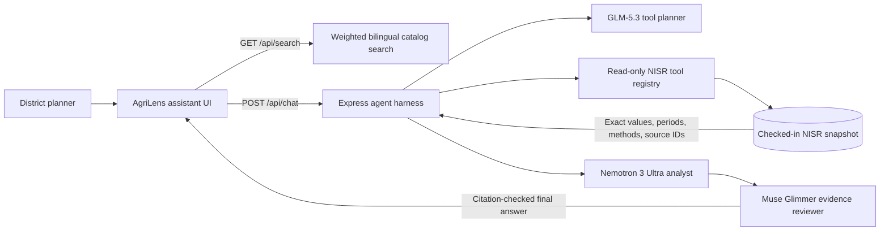

# AgriLens assistant architecture and search

**Reviewed:** 14 October 2026. This document records the shipped branch design, current safeguards, and the next steps for turning the prototype into a durable planning service.

## Why the provider default changed

NVIDIA’s Kimi K3 model page says its API is deprecated on 14 October 2026 and will no longer be supported after 15 October 2026. Keeping it as AgriLens’s default would create an immediate service-interruption risk. The assistant now uses three configurable NVIDIA-hosted roles: `z-ai/glm-5.3` plans and calls the read-only tools, `nvidia/nemotron-3-ultra-550b-a55b` synthesizes evidence, and `meta/muse-glimmer-30b` reviews the draft.[1] [7] [8] [9]

GLM-5.3 emits OpenAI-compatible tool calls and separate reasoning; NVIDIA recommends `clear_thinking=true` for chat.[2] [3] [11] Its planner request uses `temperature=0.5`, `top_p=1`, and `max_tokens=1024`. Nemotron’s streamed analyst request uses `temperature=1`, `top_p=0.95`, and `max_tokens=16384`, with `chat_template_kwargs.enable_thinking=true`; the stream parser discards `reasoning_content`.[9] [10] Muse reviews the draft without tools, using `temperature=1`, `top_p=0.95`, and `max_tokens=8192`.[7] [8] A `REVISE` review triggers at most one Nemotron correction. The client receives the answer only after this review, with NISR citation IDs restricted to sources returned by the deterministic tools. If Muse is unavailable, the answer continues only after the deterministic citation check. Live access remains unverified until the deployment secret can access all three models.

## Shipped system



- **Search:** `GET /api/search?q=...&limit=...` and the assistant’s bilingual search panel share one local catalog. Weighted lexical ranking covers indicator definitions, 2025/2026 observations, district land, derived province yields, and all 35 workbook tables. English/Kinyarwanda crop and indicator aliases and official province/district names are supported. Core workbook measures are indexed as crop-specific value records (crop × metric × period, plus district/province where reported), so a wide table row cannot be mistaken for another crop’s value. Explicit geography and metric intent receive ranking boosts, and result sets limit repeated rows from any one workbook table. Results include period, location, units and source link.
- **Read-only tool registry:** the model can call only `search_agri_data`, `get_agri_data_catalog`, `query_nisr_snapshot`, and `analyze_nisr_data`. The catalog reports coverage and limitations; snapshot queries retrieve exact records; analysis functions compute the supported comparisons and rankings deterministically. There is no free-form SQL, shell, filesystem, write, or external-action tool.
- **Analysis available now:** 2025A-to-2026A national crop production comparisons, district crop-production rankings from Table 15, province/city crop-yield rankings from the verified area-weighted derivation, district land comparisons, and national-indicator comparisons where both periods exist.
- **Grounding:** the agent must call data tools before making statistical or coverage claims; tool outputs carry exact source IDs, units, periods, calculation notes and caveats. The system prompt tells it to treat returned data as evidence—not instructions—cite only returned source IDs, distinguish production/area/yield, state missing data and avoid causal or policy claims. The UI turns recognized citations into source links.
- **Bounded harness:** validates 1–12 recent messages and message-size limits; enforces JSON-Schema types, enums, key allowlists and numeric bounds again on the server; caps a request at 3 tool rounds, 6 tool calls, 50,000 characters of retrieved evidence, and 180 seconds; applies a 12-request-per-IP-per-minute in-memory chat limit; and buffers model output until the evidence review completes. Only final-answer content is sent to the browser; internal reasoning, prompts, arguments and data values are not logged. Operational tool traces record tool name, availability, duration and citation count.
- **Bilingual interaction:** the search affordance, assistant status, error/empty states, and handoff from a result to a question have English and Kinyarwanda text. The model is also instructed to answer in the user’s language.

## Search choice and growth path

Modern hybrid search can combine lexical and vector retrieval, merge ranked candidates with Reciprocal Rank Fusion, and apply structured filters.[6] AgriLens currently has a small, checked-in, mostly structured statistical snapshot. Here, exact crop/indicator aliases, geography, period, units, and numeric rows are more reliable for statistical answers than semantic similarity. The current weighted lexical search is intentionally simple, fast, reproducible, and auditable; it does **not** claim vector or semantic retrieval.

If the content base expands to include many narrative reports, advisories, regulations, or locally authored plans, introduce a hybrid candidate retriever with metadata filters, lexical+vector fusion, reranking, and source-page/paragraph citations. Continue routing numeric claims through exact structured-data tools rather than relying on retrieved prose.

## Evaluation and operating the prototype

Modern agent reliability requires testing the harness and completed outcomes, not only asking whether a generated answer sounds fluent. Anthropic emphasizes repeatable tasks, trials, graders, and execution traces; OpenAI stresses clear boundaries and mechanically enforced invariants.[4][5]

Run:

```bash
pnpm run test:agri-assistant
```

This builds the real Express bundle and runs 10 deterministic cases covering Kinyarwanda crop and province retrieval, crop-correct district evidence, source links, Table 15 district ranking, Table 6 arithmetic, area-weighted province yields, exact indicator filters, unsupported periods, invalid arguments and disallowed tools. It then starts the built server against a mocked NVIDIA-compatible provider and exercises GLM tool planning, streamed Nemotron analysis, Muse review, one reviewer-triggered correction, citation validation, progress states, and private-reasoning suppression. These tests make **no live NVIDIA API call**. Keep a separate deployment smoke test for the configured key’s access to all three model IDs and review representative English/Kinyarwanda tasks before policy or budget use.

## Deployment and production hardening

- Put `NVIDIA_API_KEY` in the API server’s secret manager only. Configure `NVIDIA_GLM_MODEL`, `NVIDIA_NEMOTRON_MODEL`, and `NVIDIA_MUSE_MODEL` separately, plus `NVIDIA_REASONING_EFFORT` and optionally `NVIDIA_BASE_URL`; `NVIDIA_MODEL` remains a legacy GLM-planner alias. Never embed a provider key in the frontend or Git. If an actual provider key has been shared in a chat transcript, rotate it and configure a replacement secret.
- The in-memory rate limit is process-local. Before a multi-instance or public production launch, replace it with a shared limiter and add user/role authentication, service-health monitoring, latency/error dashboards, and a tested recovery/runbook.
- Gather evaluator failures and planner feedback without storing sensitive chat content by default. Add human-reviewed Kinyarwanda grounding and citation-quality cases; distinguish tool correctness from response helpfulness.
- Keep refresh/import and integrity validation as the auditable data-ingest boundary. Do not silently treat missing values as zero or derived provincial statistics as official NISR releases.

## References

[1]: https://build.nvidia.com/moonshotai/kimi-k3/modelcard "NVIDIA Kimi K3 model card and API lifecycle notice"
[2]: https://build.nvidia.com/z-ai/glm-5-3/modelcard "NVIDIA GLM-5.3 model card"
[3]: https://docs.nvidia.com/nim/large-language-models/latest/reference/api-reference.html "NVIDIA NIM LLM API reference"
[4]: https://www.anthropic.com/engineering/demystifying-evals-for-ai-agents "Anthropic: Demystifying evals for AI agents"
[5]: https://openai.com/index/harness-engineering/ "OpenAI: Harness engineering"
[6]: https://learn.microsoft.com/en-us/azure/search/hybrid-search-overview "Microsoft Learn: Hybrid search overview"
[7]: https://build.nvidia.com/meta/muse-glimmer-30b/modelcard "NVIDIA Muse Glimmer 30B model card"
[8]: https://docs.api.nvidia.com/nim/reference/meta-muse-glimmer-30b "NVIDIA Muse Glimmer API reference"
[9]: https://build.nvidia.com/nvidia/nemotron-3-ultra-550b-a55b/modelcard "NVIDIA Nemotron 3 Ultra 550B A55B model card"
[10]: https://docs.api.nvidia.com/nim/reference/nvidia-nemotron-3-ultra-550b-a55b "NVIDIA Nemotron 3 Ultra API reference"
[11]: https://docs.api.nvidia.com/nim/reference/z-ai-glm-5-3 "NVIDIA GLM-5.3 API reference"
